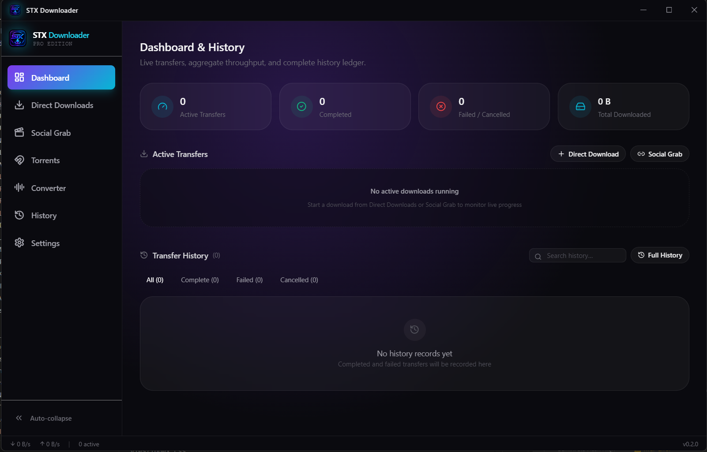

# SHANUTECHX Downloader

A modern, powerful desktop download manager built with Electron, React, and TypeScript. Download files from HTTP/HTTPS, social media platforms (YouTube, TikTok, Instagram, etc.), torrents, and convert media files - all with an elegant, user-friendly interface.



## ✨ Features

### 🚀 Multi-Protocol Downloads
- **HTTP/HTTPS Downloads** - Multi-segment parallel downloading for maximum speed
- **Social Media Support** - Download from YouTube, TikTok, Instagram, Twitter, Facebook, and 1800+ sites via yt-dlp
- **Adult Content Support** - Download from Pornhub, Xvideos, and other adult platforms (privacy-focused, all local)
- **Torrent Support** - Built-in WebTorrent engine for P2P downloads
- **Smart Resume** - Automatic resume on network errors with exponential backoff

### 🎨 Beautiful UI/UX
- **Modern Dark Theme** - Elegant glass-morphism design with improved sidebar
- **Real-Time Progress** - Live speed, ETA, and transfer statistics
- **Toast Notifications** - Non-intrusive feedback for all actions
- **Custom Title Bar** - Frameless window with working minimize/maximize/close buttons
- **Responsive Layout** - Clean, organized interface that scales beautifully
- **Collapsible Sidebar** - Space-efficient navigation with smooth animations

### ⚡ Advanced Features
- **Speed Limiting** - Global and per-file bandwidth controls with real token bucket implementation
- **Concurrent Downloads** - Download multiple files simultaneously
- **Multi-Segment Downloads** - Split files into segments for faster downloads
- **Retry Strategy** - Smart retry logic that skips permanent failures (404, 403)
- **Proxy Support** - HTTP and SOCKS5 proxy with secure credential storage in OS keychain
- **Media Conversion** - Extract audio, convert formats using bundled FFmpeg
- **Auto-Updates** - Automatic updates via GitHub releases

### 🔒 Security & Privacy
- **Context Isolation** - Electron security best practices enforced
- **Secure Credential Storage** - Proxy passwords stored in OS keychain, never in plaintext
- **Sandboxed Renderer** - No nodeIntegration, full content security
- **Certificate Validation** - TLS verification enabled by default (opt-in to disable)

### 🛠️ Zero Configuration
- **Auto-Download Binaries** - yt-dlp and FFmpeg automatically downloaded on first launch
- **No Manual Setup** - Everything works out of the box
- **Windows Support** - Built specifically for Windows platform

## 📦 Installation

### Download Pre-Built Binaries

Download the latest release for Windows from the [Releases](https://github.com/ShanudhaTirosh/shanutechx-downloader/releases) page:

- **Windows**: `SHANUTECHX-Downloader-Setup-{version}.exe`

### Build from Source

#### Prerequisites

- Node.js 20+ and pnpm 9+
- Git

#### Clone and Install

```bash
git clone https://github.com/ShanudhaTirosh/shanutechx-downloader.git
cd shanutechx-downloader
pnpm install
```

#### Development

Run the app in development mode with hot-reload:

```bash
pnpm dev
```

This starts both the React renderer (Vite dev server) and Electron main process.

#### Build

Build the application for production:

```bash
# Build both main and renderer
pnpm build

# Package into executable
pnpm package
```

The packaged application will be in `apps/main/dist/`.

## 🚀 Usage

### Basic Downloads

1. Go to **Downloads** tab
2. Paste a URL and click **Start Download**
3. Watch real-time progress with speed and ETA

### Social Media Downloads

1. Go to **Social Grab** tab
2. Paste a URL from supported sites:
   - **Video Platforms**: YouTube, TikTok, Instagram, Vimeo, Dailymotion
   - **Social Media**: Twitter/X, Facebook, Reddit
   - **Adult Content**: Pornhub, Xvideos, and 1000+ other sites
   - **Live Streaming**: Twitch, YouTube Live
   - And many more (yt-dlp supports 1800+ sites)
3. Click **Extract** to see available qualities
4. Select quality and click **Download**

**Note**: Your app respects your privacy - all downloads happen locally on your machine.

### Torrents

1. Go to **Torrents** tab
2. Paste a magnet link
3. Click **Add** to start downloading
4. Monitor peers, speed, and progress

### Media Conversion

1. Go to **Converter** tab
2. Click **Browse** to select a video/audio file
3. Click **Extract Audio** to convert to MP3
4. Track progress on the Dashboard

## ⚙️ Settings

### Downloads
- **Max Simultaneous Downloads** - Control how many files download at once (1-20)
- **Segments per Download** - Split files into segments for parallel downloading (1-32)

### Speed Limits
- **Global Speed Limit** - Maximum total speed across all downloads (KB/s, 0 = unlimited)
- **Per-File Speed Limit** - Maximum speed for each individual file (KB/s, 0 = unlimited)

### Proxy
- **Type** - None, HTTP, or SOCKS5
- **Host & Port** - Proxy server address
- **Credentials** - Optional username/password (stored securely in OS keychain)

### System Binaries
- **Auto-Download** - Missing binaries (yt-dlp, ffmpeg, ffprobe) are automatically downloaded
- **Manual Download** - Click "Download Missing Binaries" if needed

### App Updates
- **Check for Updates** - Manually check for new versions
- **Auto-Update** - Updates downloaded from GitHub releases
- **One-Click Install** - Download and restart to update

## 🏗️ Architecture

### Technology Stack

- **Electron** - Cross-platform desktop framework
- **React 18** - UI library with hooks
- **TypeScript** - Type-safe development
- **Vite** - Lightning-fast dev server and bundler
- **Framer Motion** - Smooth animations
- **SQLite** (better-sqlite3) - Local database for download history
- **Drizzle ORM** - Type-safe database queries
- **Undici** - HTTP client for downloads
- **WebTorrent** - P2P torrent client
- **yt-dlp** - Social media extractor (auto-downloaded)
- **FFmpeg** - Media conversion (auto-downloaded)

### Project Structure

```
shanutechx-downloader/
├── .github/workflows/    # GitHub Actions CI/CD
├── apps/
│   ├── main/            # Electron main process
│   └── renderer/        # React frontend
├── packages/
│   └── shared-types/    # Shared TypeScript types
├── docs/                # Documentation
│   ├── SETUP.md
│   ├── CHANGELOG.md
│   └── IMPROVEMENTS.md
└── package.json         # Root workspace config
```

### Key Design Decisions

1. **Type-Safe IPC** - All main↔renderer communication typed in `shared-types` package
2. **Single Source of Truth** - QueueManager broadcasts all download state; renderer never guesses
3. **Real Settings** - Every setting has a tested code path that actually uses it
4. **Security First** - No nodeIntegration, context isolation, sandboxed renderer
5. **Automatic Binaries** - No manual configuration; yt-dlp and FFmpeg downloaded automatically
6. **Smart Retry** - Exponential backoff with permanent failure detection (404, 403, etc.)

## 🤝 Contributing

Contributions are welcome! Please follow these guidelines:

1. Fork the repository
2. Create a feature branch (`git checkout -b feature/amazing-feature`)
3. Commit your changes (`git commit -m 'Add amazing feature'`)
4. Push to the branch (`git push origin feature/amazing-feature`)
5. Open a Pull Request

### Development Guidelines

- Follow the existing code style (TypeScript, ESLint)
- Write descriptive commit messages
- Test your changes in dev mode before submitting
- Update documentation for new features
- Keep the IPC contract in sync (update `shared-types`)

## 📝 License

This project is licensed under the MIT License - see the [LICENSE](LICENSE) file for details.

## 🙏 Acknowledgments

- [yt-dlp](https://github.com/yt-dlp/yt-dlp) - Powerful media extractor
- [FFmpeg](https://ffmpeg.org/) - Multimedia framework
- [WebTorrent](https://webtorrent.io/) - Streaming torrent client
- [Electron](https://www.electronjs.org/) - Cross-platform desktop apps
- [React](https://react.dev/) - UI library
- [Vite](https://vitejs.dev/) - Build tool
- [Framer Motion](https://www.framer.com/motion/) - Animation library

## 📞 Support

- **Website**: [info.shanutechx.com](https://info.shanutechx.com)
- **Email**: [info@shanutechx.com](mailto:info@shanutechx.com)
- **Issues**: [GitHub Issues](https://github.com/ShanudhaTirosh/shanutechx-downloader/issues)
- **Discussions**: [GitHub Discussions](https://github.com/ShanudhaTirosh/shanutechx-downloader/discussions)

## 🗺️ Roadmap

- [ ] Drag & drop support for torrents and files
- [ ] Download scheduler
- [ ] Browser extension for easy downloads
- [ ] Cloud sync for download history
- [ ] Light theme
- [ ] More conversion presets (H.264, H.265, AV1)
- [ ] Playlist/batch downloads from social media
- [ ] Chrome extension integration
- [ ] Multi-language support

---

**Built with ❤️ by [Shanudha Tirosh](https://info.shanutechx.com)**

## 🔧 Troubleshooting

### Black Screen on Launch

If you see a black screen:

1. Stop the development server
2. Run `pnpm dev` again
3. Check the console for errors

The most common cause is Vite module resolution errors. The fix is to restart the dev server.

### Binaries Not Downloading

If yt-dlp or FFmpeg fail to download:

1. Check your internet connection
2. Try manual download from Settings → System Binaries
3. Check the console logs for specific errors

Binaries are downloaded to your app's userData directory:
- Windows: `%APPDATA%\SHANUTECHX Downloader\binaries`

### Updates Not Working

If auto-updates aren't working:

1. Make sure you built from a tagged release commit
2. Check the electron-builder.yml has the correct GitHub username
3. Verify GitHub releases are public
4. Check Settings → App Updates for error messages

---

## 📚 Documentation

- **[Setup Guide](docs/SETUP.md)** - Detailed setup and configuration instructions
- **[Changelog](docs/CHANGELOG.md)** - Version history and release notes
- **[Improvements](docs/IMPROVEMENTS.md)** - Technical improvements and bug fixes
- **[Supported Sites](docs/SUPPORTED-SITES.md)** - Complete list of 1800+ supported platforms
- **[Adult Content Support](docs/ADULT-CONTENT-SUPPORT.md)** - Privacy-focused downloading guide

---

**Star ⭐ this repo if you find it useful!**
